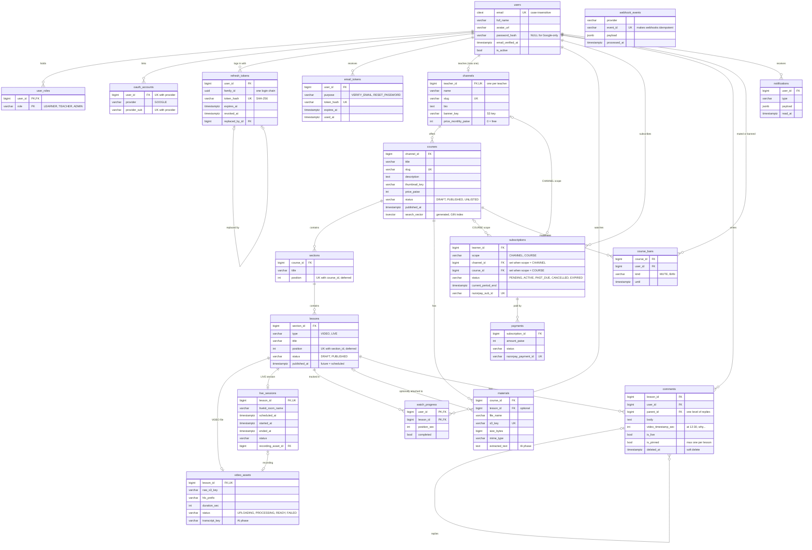

# LearnerHub data model

This is the design for the **whole** system. Tables are built in the phase that needs them, each with its own Alembic migration. Tables not built yet are a design, and may change when their phase starts. Update this file whenever a migration changes the schema.

| Table | Module | Status |
|---|---|---|
| `users`, `user_roles` | users | ✅ Built (Phase 1) |
| `oauth_accounts`, `refresh_tokens`, `email_tokens` | auth | ✅ Built (Phase 1) |
| `channels` | channels | ✅ Built (Phase 1) |
| `courses`, `sections`, `lessons` | courses | ✅ Built (Phase 1) |
| `video_assets`, `watch_progress` | media | Designed (Phase 3) |
| `materials` | materials | Designed (Phase 4) |
| `subscriptions` | subscriptions | Designed (Phase 4) |
| `payments`, `webhook_events` | payments | Designed (Phase 4) |
| `comments`, `course_bans` | comments | Designed (Phase 5) |
| `live_sessions` | live | Designed (Phase 6) |
| `notifications`, `push_subscriptions`, `lesson_view_counts` | notifications | Designed (Phase 7) |
| `reports` | admin | Designed (Phase 8) |

## Diagram

Every table has `id` (BIGINT identity) and `created_at`. Most also have `updated_at`. These columns are left out below to keep the diagram readable. Tables from Phase 7–8 that only add counters or reports are also left out.



## Rules the schema enforces

These are enforced by Postgres itself, so even a buggy service or a manual SQL edit can't break them.

| Rule | How |
|---|---|
| An email is registered once, ignoring letter case | `users.email` is `CITEXT UNIQUE` |
| A user holds each role at most once | primary key `(user_id, role)` |
| A Google account links to one user, and a user links one Google account | `UNIQUE(provider, provider_sub)` and `UNIQUE(user_id, provider)` |
| A teacher has at most one channel | `UNIQUE(channels.teacher_id)` |
| Slugs are URL-safe and unique | `CHECK (slug ~ '^[a-z0-9]+(-[a-z0-9]+)*$')` plus `UNIQUE` |
| Prices are never negative; money is exact | integer paise with `CHECK (>= 0)` |
| Positions within a course or section are unique, but can be swapped in one transaction | `UNIQUE(parent_id, position) DEFERRABLE INITIALLY DEFERRED` |
| A published course or lesson records when it was published | `CHECK (status = 'DRAFT' OR published_at IS NOT NULL)` |
| Enum columns only hold known values | a `CHECK (col IN (...))` per enum |
| *(Phase 4)* A subscription points at exactly the target its scope says | `CHECK` on `scope` + `channel_id` + `course_id` |
| *(Phase 4)* At most one live subscription per learner and target | partial `UNIQUE` index on PENDING, ACTIVE and PAST_DUE |
| *(Phase 5)* At most one pinned comment per lesson | partial `UNIQUE` index where `is_pinned` |

## What happens on delete

| Deleting a… | Effect |
|---|---|
| user | Their roles, linked accounts and tokens are deleted (`CASCADE`). **Blocked** if they own a channel (`RESTRICT`): disable the account with `is_active = false` instead. |
| channel | **Blocked** while it has courses (`RESTRICT`). |
| course | Its sections and lessons are deleted (`CASCADE`). |
| section | Its lessons are deleted (`CASCADE`). |

## The access rule

Everything a learner can open (video, materials, comments, live) goes through one check:

```
can_access(user, course) =
       user owns the course's channel
    OR user has an ACTIVE subscription with scope COURSE  and course_id  = course.id
    OR user has an ACTIVE subscription with scope CHANNEL and channel_id = course.channel_id
```

The spec stores the subscription target as a single `target_id`. Here it's two columns, `channel_id` and `course_id`, because Postgres can't enforce a foreign key on a column that sometimes means a channel and sometimes a course. With two real foreign keys, a subscription can never point at a deleted or nonexistent target, and both lookups in the rule above get an index.
